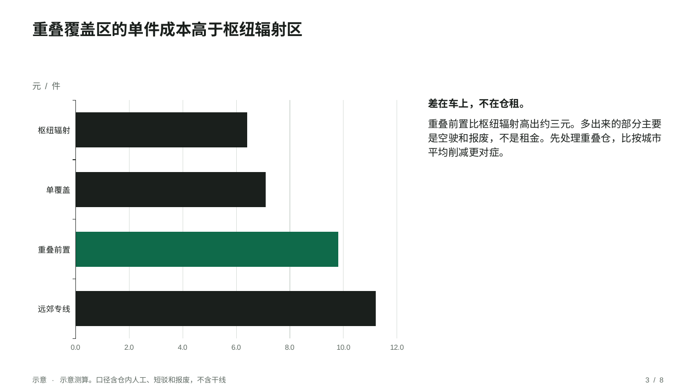
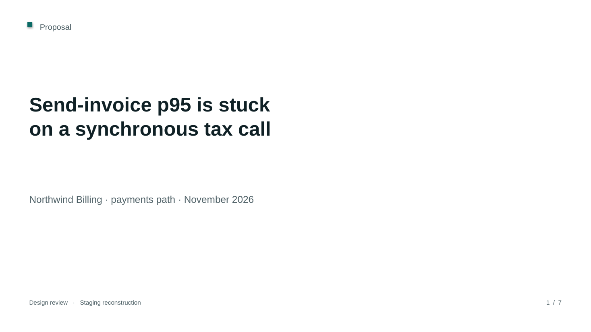
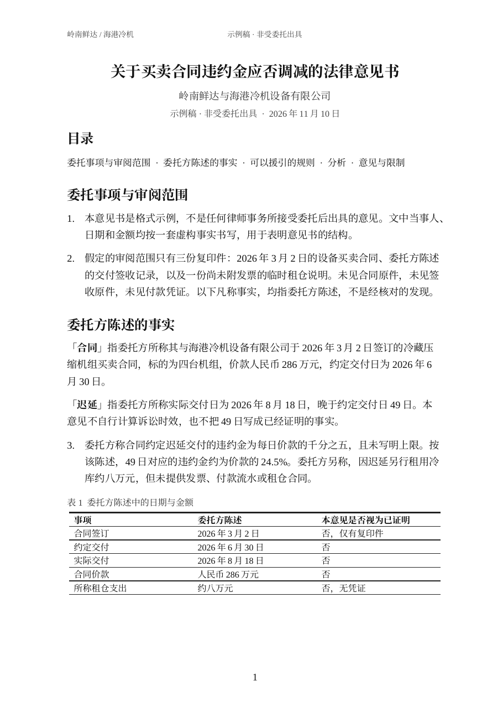
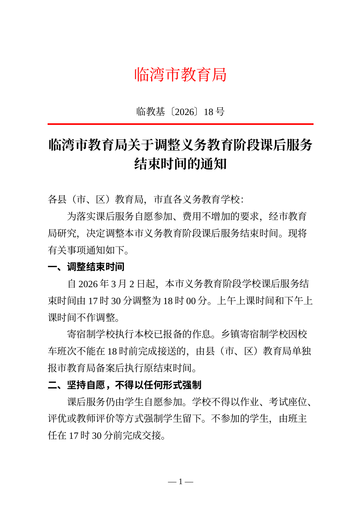
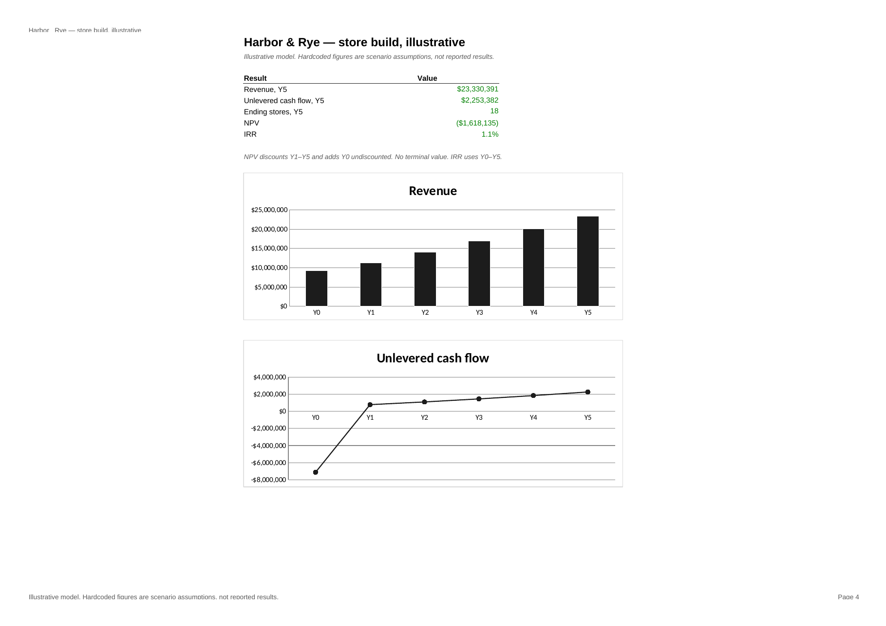
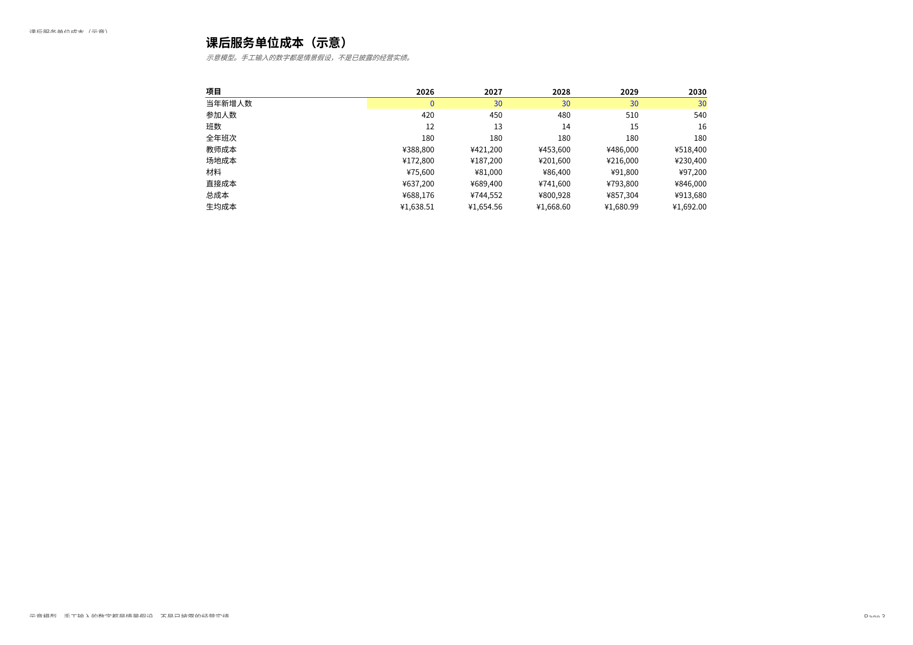
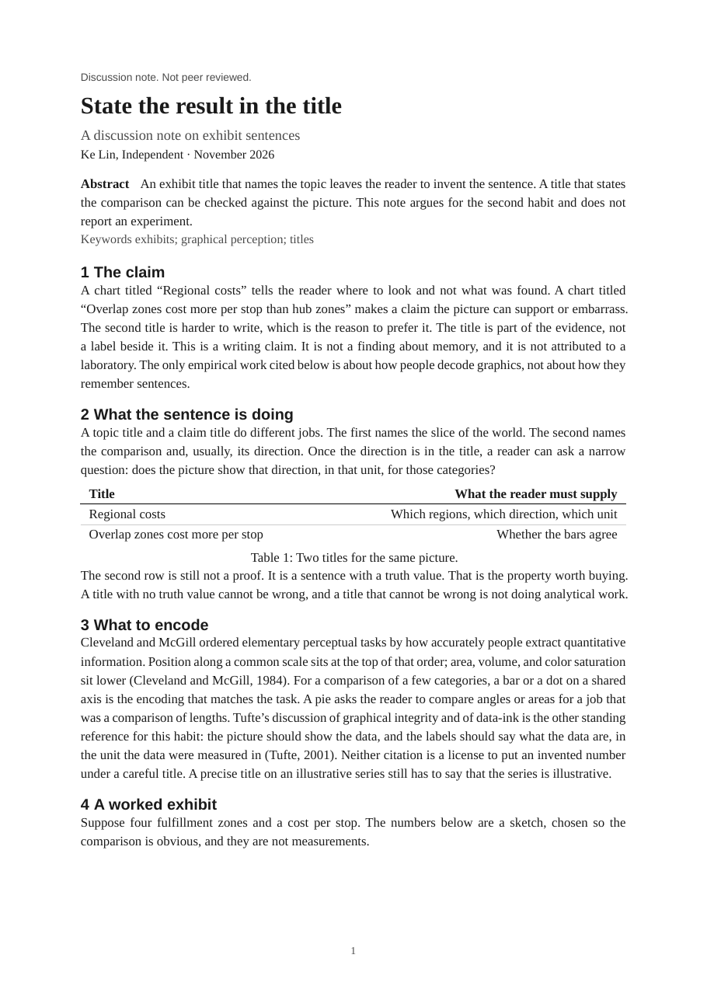
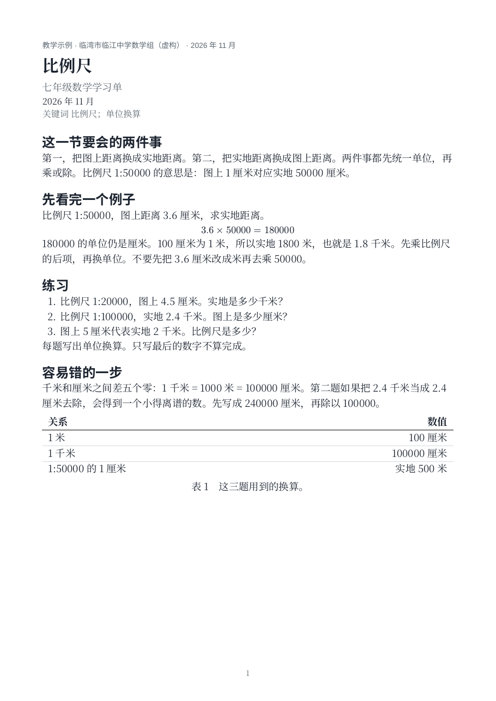

# Office-Skill

用三个输入生成一份看起来像专业人士写的文件：**文件类型**、**专业领域**、**提示**。可选地带上资料。不需要选模板，也不需要指定库。

支持 PPTX、DOCX、XLSX、PDF。简体中文和英文都是一等输出。领域决定版式、字体、颜色和写法，而不是套一层通用的蓝条主题。

内容先写成结构化计划（大纲、判断、图表、来源），再由固定的版式函数画出来。模型不写坐标，也不手写 OOXML。机器闸门负责占位符、出框、字体、公式重算和 Typst 编译；人（或另一轮阅读）必须看渲染后的页面。

## 安装

系统侧需要 LibreOffice、`pdftoppm`，以及剖面里点名的字体（Noto CJK、Liberation）。

```bash
bash scripts/install_tools.sh
```

只装 Python 依赖时：

```bash
python -m pip install -e ".[dev]"
```

WeasyPrint 是可选的 HTML 转 PDF 路径，不在默认依赖里。示例都走 Typst。

## 用法

调用方只给这三样：

| 输入 | 取值 |
| --- | --- |
| `file_type` | `pptx`、`docx`、`xlsx`、`pdf` |
| `domain` | 见下表。`marketing` 等同 `brand`，`公文` 等同 `government` |
| 提示 | 这份文件要决定、说明或教会什么 |

代理读 `SKILL.md`，只加载一个剖面和一种引擎，先写 `plan.json`，再渲染、过闸、看图。

```bash
python -m office_skill render plan.json -o deliverable.pptx
python -m office_skill gate deliverable.pptx --plan plan.json --preview-dir /tmp/preview --result gate.json
```

`gate.json` 里 `passed` 为假就改计划和内容再渲染。即便为真，也要打开预览目录里的每一张 PNG。交付说明写在同名的 `.delivery.md`。

## 领域

| id | 读者 | 常见成稿 |
| --- | --- | --- |
| `consulting` | 要做决定的管理层 | 讨论稿、董事会图表 |
| `finance` | 会改假设的人 | 模型、收益页。蓝字黄底是输入，黑字是公式，绿字是跨表 |
| `legal` | 委托人或同事 | 法律意见书。真实样式、目录域、编号段落 |
| `academic` | 讨论稿的读者 | Typst 文章。引用必须真实，要有局限一节 |
| `product` | 设计评审 | 问题、约束、决定 |
| `brand` | 看一条产品论述的客户 | 一页一个意思。`marketing` 是别名 |
| `government` | 收文经办人 | 公文。页边距按 GB/T 9704，红只用于红头和分隔线 |
| `education` | 教师或学生 | 学习单、单位成本表 |

没有精确来源的数字必须标成示意，或者删掉。不要编案例、DOI 或文号。

## 增加一个剖面

1. 复制 `profiles/` 里一对 `.md` 和 `.json`。文件名就是 id。
2. JSON 里写上页面、字体、字号、调色、明暗、模型配色。加载器会检查缺项。
3. Markdown 写给代理看：读者、交付物名称、写法、禁止出现的装饰、数据规则。
4. 用现有原语试渲一页封面。原语不够时再改对应引擎，不要在计划里写坐标。
5. 别名写在 `office_skill/profiles.py` 的 `ALIASES`。

## 示例

`examples/plans/` 是计划，`examples/out/` 是成稿、闸门结果和 PNG。下面每张图都过了闸门。

咨询讨论稿（中文 PPTX）：




产品评审（英文 PPTX）：



法律意见书（中文 DOCX）：



公文通知（中文 DOCX）：



财务模型（英文 XLSX，示意案例，净现值低于门槛）：



课后服务单位成本（中文 XLSX）：



讨论稿（英文 PDF）：



七年级学习单（中文 PDF）：



重新生成：

```bash
python scripts/generate_examples.py
```

## 已知限制

- v1 只生成新文件，不能安全地改一份已有的复杂 Office 文件。
- 字体不嵌入。阅读端没有 Noto CJK 和 Liberation 时，换行会变。公文的小标宋、仿宋、黑体用这两种开源字体代替，所以做不到每行恰好 28 字。
- Excel 公式在 LibreOffice 里重算。不要用 `XLOOKUP`、`FILTER` 等它算不了的函数。
- 目录是 Word 域。未在 Word 中打开时，页码可能还是缓存的标题列表。
- 示例里的机构、公司和数字都是虚构的，不是法律意见、投资建议或已经发出的公文。
- 不包含 PyMuPDF。PDF 栅格化用 `pdftoppm`。

## English

Office-Skill renders a PPTX, DOCX, XLSX, or PDF from three inputs: file type, professional domain, and a prompt. Simplified Chinese and English are both first-class.

The agent writes a structured plan, then calls named layout primitives. A gate the agent does not grade itself checks placeholders, overflow, fonts, spreadsheet recalculation, OOXML, and Typst. Looking at every rendered page is required. See `SKILL.md`.

```bash
bash scripts/install_tools.sh
python -m office_skill render plan.json -o deliverable.pptx
python -m office_skill gate deliverable.pptx --plan plan.json --preview-dir /tmp/preview
```

Domains: `consulting`, `finance`, `legal`, `academic`, `product`, `brand`, `government` (Chinese official-document layout, GB/T 9704 measurements), `education`. Add a profile by copying a pair of files in `profiles/`. Do not invent precise figures, cases, DOIs, or document numbers. Mark sketches as illustrative.

This repository is MIT. The code and the profiles are original. It does not vendor Anthropic skill files or PyMuPDF.
